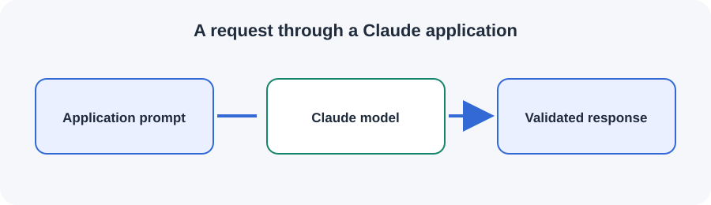

# A request through a Claude application

A high-level view of a model request, optional tool use, and the application response.

## Key ideas

- Identify the responsibility of each component.
- Keep interfaces and ownership boundaries explicit.
- Consider failure handling, security, and operational trade-offs.

Use this overview as a starting point for revision. Follow the links and examples in your own project documentation when applying the concept.
