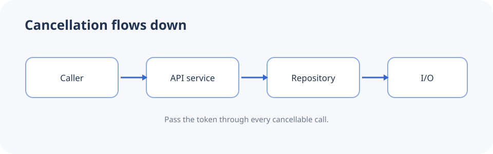

# Cancellation tokens

Cancellation in .NET is cooperative. A caller signals cancellation and each operation decides when it can stop safely.

1. Accept a `CancellationToken` in asynchronous APIs.
2. Pass it to database, HTTP, and other cancellable operations.
3. Avoid treating expected cancellation as an unexpected application failure.



```csharp
cancellationToken.ThrowIfCancellationRequested();
await httpClient.GetAsync(uri, cancellationToken);
```
