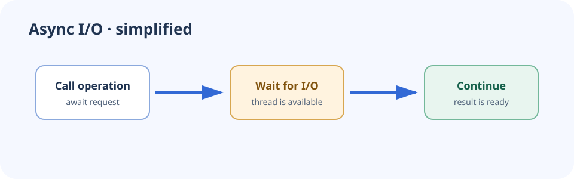

# Async and await

Asynchronous programming helps an application use its threads efficiently while waiting for I/O such as HTTP, database, or file operations.

## Key points

- `await` yields control while an asynchronous operation is incomplete.
- Async I/O improves scalability; it does not make CPU-bound work faster.
- Pass cancellation tokens through application layers.
- Avoid blocking async work with `.Result` or `.Wait()`.



```csharp
public async Task<Customer?> FindAsync(
    int id,
    CancellationToken cancellationToken)
{
    return await repository.FindAsync(id, cancellationToken);
}
```
