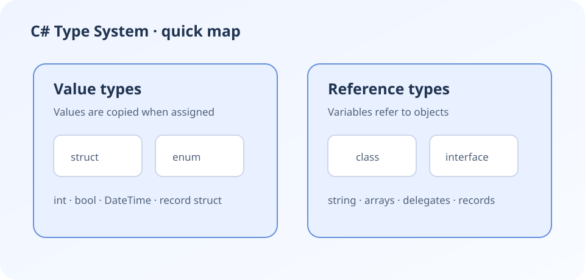

# C# Fundamentals

A quick map of the language concepts that come up often in interviews.

## Core areas

- Value types and reference types
- Interfaces, inheritance, and composition
- Generics and collections
- Records and immutability



## Example: a small immutable data model

```csharp
public sealed record Customer(int Id, string Name);

var customer = new Customer(42, "Ada");
Console.WriteLine(customer.Name);
```

Prefer a type that makes the domain intent clear. Use a record when value-based equality and concise data modeling are appropriate.
