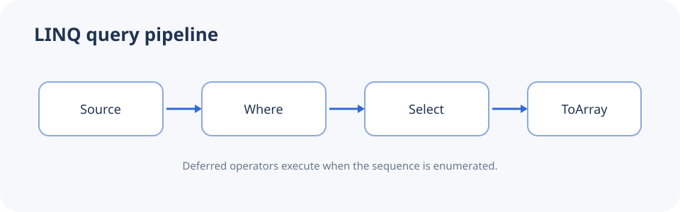

# LINQ and collections

Select a collection based on the operations and guarantees the code needs. LINQ query operators often use deferred execution until enumeration.

## Example: filter and project

```csharp
var names = customers
    .Where(customer => customer.IsActive)
    .Select(customer => customer.Name)
    .ToArray();
```

Materialize deliberately when you need a stable snapshot or want to execute a remote query at a clear boundary. Avoid repeated enumeration of an expensive or stateful source.


